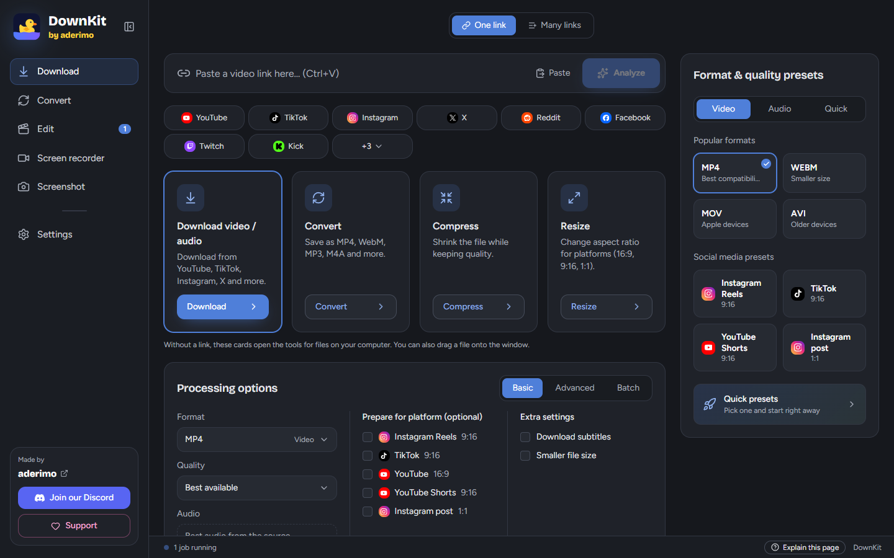
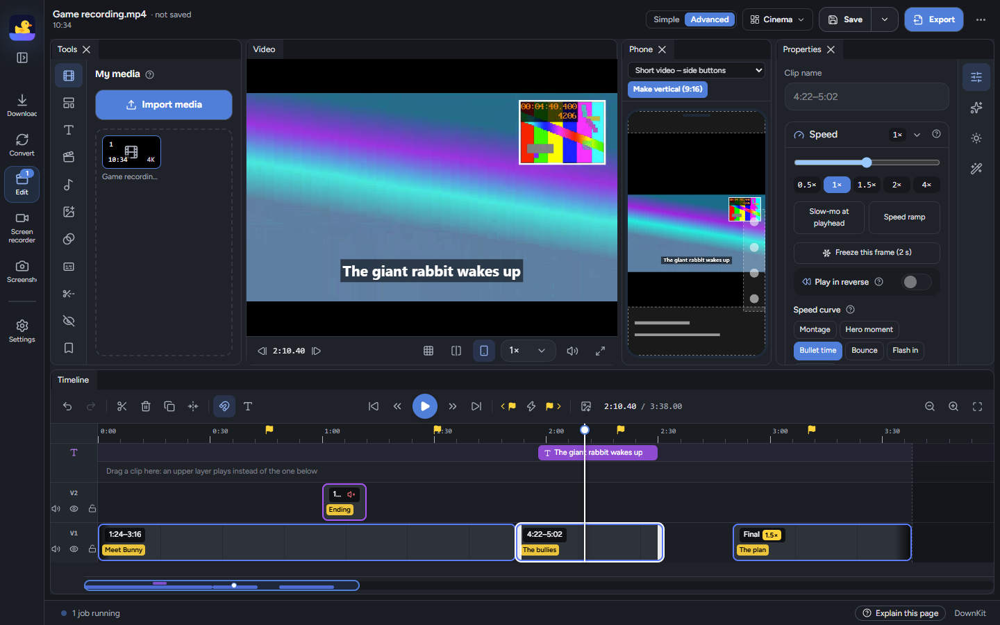
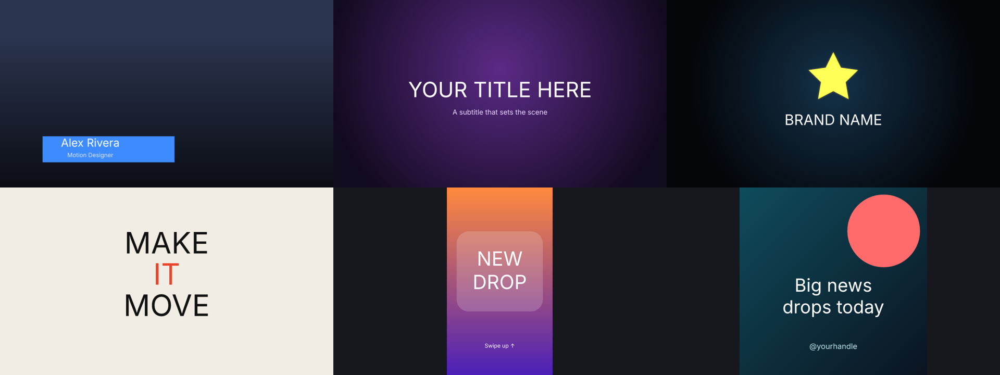
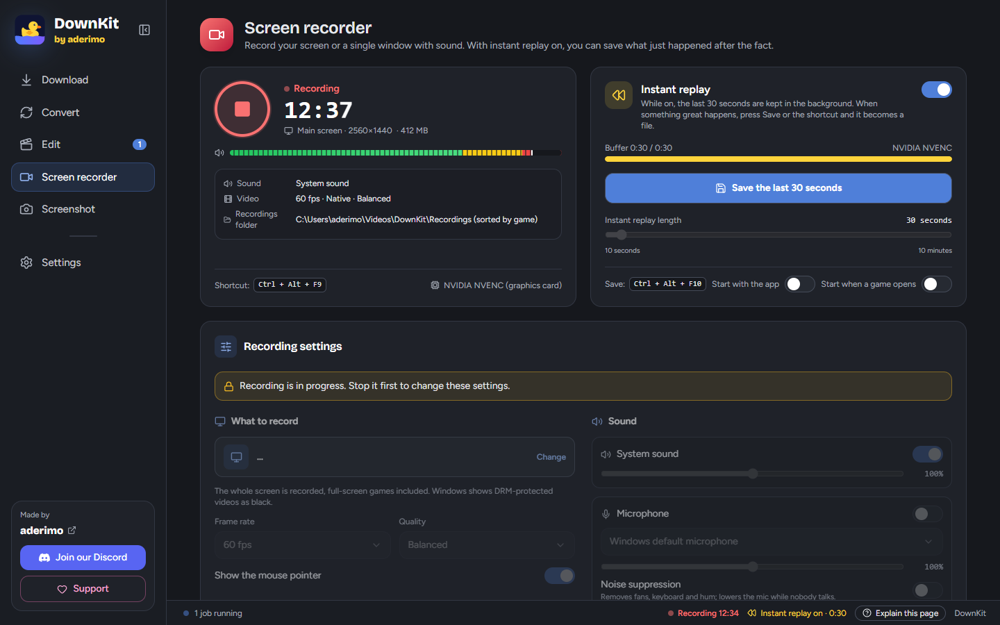
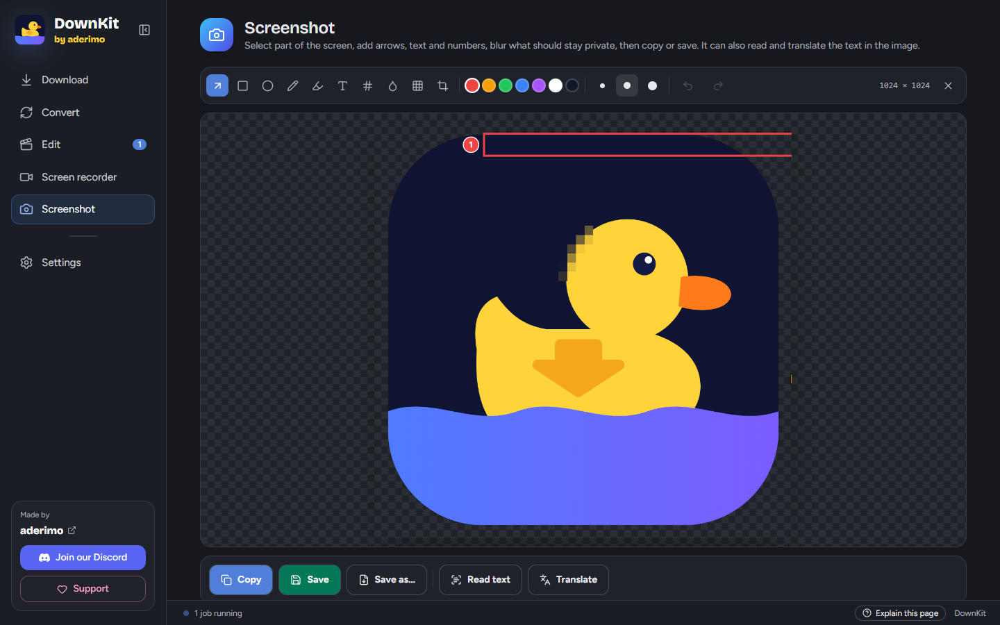

<div align="center">


# DownKit

**Download. Convert. Edit. Record. Capture.**

A free, open-source media app for Windows — everything from "paste a link" to "post the
finished clip" in one window. No account, no ads, no paywall.

[](https://github.com/Aderimo/downkit/releases/latest)
[](https://github.com/Aderimo/downkit/releases)
[](LICENSE)
[](#install)
[](https://discord.gg/z72EaBazJG)

### [⬇ Download DownKit.exe](https://github.com/Aderimo/downkit/releases/latest)

**English** · [Türkçe](README.tr.md)

</div>



---

## Why DownKit?

Most tools do one thing: a downloader gives you "a video file", then you need a converter to
change the format, another tool to make it small enough for Discord, an editor to cut it and
add a title, and a recorder for your screen. DownKit puts all of that in one simple app — no
codecs, bitrates or command lines to learn.

It is **open source** (MIT): anyone can read the code, check that it does nothing behind your
back, suggest improvements or build on it. It stays free.

## What it does

### ⬇ Download from a link

Paste a link from **YouTube, TikTok, Instagram, X, Reddit, Facebook, Twitch, Kick** and hundreds
of other sites. Pick MP4, MP3, WebM… and the quality; DownKit shows the title, length and
estimated size first.

- Download **only a part** of a long video — the rest is never downloaded.
- Whole playlists, subtitles, SponsorBlock, speed limit, download history.
- **Open in editor** with one click when the download finishes.

### 🔄 Convert, compress, resize

Change the format of video, audio or images; compress to a **target size** (e.g. under 10 MB
for Discord); resize for TikTok, Reels or Shorts (9:16, 1:1, 4:5…). Drop many files and run
the same job on all of them.

### 🎬 Clip editor



Multi-track timeline, split with **S**, ripple delete, J/L cuts, keyframes with easing, timed
zoom, 47 transitions, look effects, colour correction, text, logos and stickers, undo/redo.

- **Vertical video**: camera + game layouts, face-tracking crop, live phone preview with safe
  areas, one project exported to 9:16 / 1:1 / 4:5 / 16:9.
- **Captions**: on-device automatic captions, style gallery, active-word highlight, transcript
  editor, SRT / VTT.
- **Audio**: noise / wind / echo repair, bass-mid-treble equaliser, compressor, limiter,
  social media loudness, beat-synced cuts, voiceover.

### ✨ Motion titles



Animated lower thirds, title cards, logo reveals, kinetic type and social templates — type
your text, pick a colour, place it over the video. Drawn by the open-source
[EffectCraft](https://github.com/storytold/effectcraft) engine. Lottie (`.json`) animations
work too.

### 🔴 Screen recording and instant replay



Record a screen, a window or several monitors with desktop audio and a separate microphone
track. Instant replay keeps the last seconds in memory — press a shortcut after something
great happens.

### 📸 Screenshots



Select an area on a frozen screen (**Alt+Shift+S**), add arrows, text and numbered steps, blur
what's private, then copy or save. It can read the text in the image (OCR) and translate it.

## Install

Download from the [latest release](https://github.com/Aderimo/downkit/releases/latest):

| File                            | What it is                                        |
| ------------------------------- | ------------------------------------------------- |
| **`DownKit-X.Y.Z.exe`**         | Just double-click — no install                    |
| `DownKit-X.Y.Z-kurulum.exe`     | Installer (Start menu shortcut, uninstaller)      |
| `DownKit-X.Y.Z-tasinabilir.zip` | The same `DownKit.exe` in a zip, right at the top |
| `SHA256SUMS.txt`                | Checksums to verify the download                  |

Requirements: Windows 10 / 11 (64-bit) and Microsoft Edge WebView2 (built into Windows 11).
If Windows shows "unknown publisher": **More info → Run anyway**.

On first launch DownKit downloads FFmpeg, yt-dlp and Deno once. Settings live in
`%APPDATA%\com.aderimo.downkit`; settings from DownKit 0.3 and ClipKit move over automatically.

## Privacy

No telemetry, no account. Editing, recording and captions run on your computer; your files are
never uploaded. DownKit only goes online to download the links you paste, to fetch its tools
from their official pages and to check GitHub for a new version.

Please only download content you have the right to download. DownKit does not bypass DRM or
access restrictions.

## Author

DownKit is made by **aderimo**.

- 🌐 All my links and social media: **[gitgit.me/aderimo](https://gitgit.me/aderimo)**
- 💬 Community and help: [Discord](https://discord.gg/z72EaBazJG)
- 🐞 Bugs and ideas: [GitHub Issues](https://github.com/Aderimo/downkit/issues) — every error in
  the app has a **Report** button that fills one in for you
- ☕ Support the project (optional): [donate.bynogame.com/aderimo](https://donate.bynogame.com/aderimo)

## Development

Requirements: Node.js 22, pnpm, Rust (stable) and the
[Tauri prerequisites](https://tauri.app/start/prerequisites/) for Windows.

```bash
pnpm install
pnpm tauri dev
```

Checks: `pnpm typecheck`, `pnpm lint`, `pnpm test`, `pnpm format:check`, `pnpm test:e2e`, and
in `src-tauri`: `cargo fmt --check`, `cargo clippy`, `cargo test --lib`. Packaging:
`paketle.bat` ([docs/RELEASING.md](docs/RELEASING.md)). Contributions:
[CONTRIBUTING.md](CONTRIBUTING.md).

## License

[MIT](LICENSE) © 2026 aderimo. The name and duck logo: [TRADEMARKS.md](TRADEMARKS.md).
Open-source components: [THIRD_PARTY_NOTICES.md](THIRD_PARTY_NOTICES.md).
