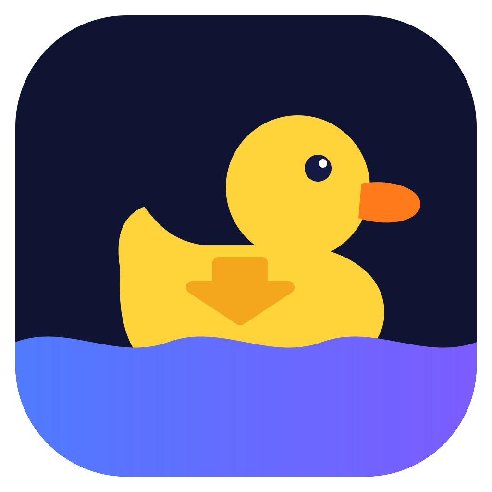

<div align="center">



# DownKit

İndir, dönüştür, düzenle, kaydet, ekran görüntüsü al — Windows 10 / 11 için tek, ücretsiz ve
açık kaynak program.

[English](README.md) · **Türkçe**

### [⬇ DownKit.exe'yi indir](https://github.com/Aderimo/downkit/releases/latest)

[Sürümler](https://github.com/Aderimo/downkit/releases) ·
[Hata bildir](https://github.com/Aderimo/downkit/issues/new) ·
[Discord](https://discord.gg/z72EaBazJG)

</div>

## Kurulum

Son sürümü [Sürümler sayfasından](https://github.com/Aderimo/downkit/releases/latest) indir:

- **`DownKit-X.Y.Z.exe`** — indir, çift tıkla; kurulum gerekmez.
- **`DownKit-X.Y.Z-kurulum.exe`** — kurulum (Başlat menüsü kısayolu, kaldırıcı).
- **`DownKit-X.Y.Z-tasinabilir.zip`** — aynı `DownKit.exe` zip içinde, en üstte.

Her sürümde SHA-256 özetleri `SHA256SUMS.txt` dosyasındadır.

Gereksinimler: Windows 10 / 11 (64 bit) ve Microsoft Edge WebView2 (Windows 11'de hazır gelir).
Windows "bilinmeyen yayımcı" derse: **Ek bilgi → Yine de çalıştır**.

İlk açılışta DownKit FFmpeg, yt-dlp ve Deno'yu bir kez indirir. Otomatik altyazı ilk
kullanımda whisper.cpp'yi ve bir konuşma modelini indirir. Ayarlar
`%APPDATA%\com.aderimo.downkit` klasöründedir. ClipKit ya da DownKit 0.3'ten ayarlar ve
projeler kendiliğinden taşınır.

## Neler yapar

- **İndir**: YouTube, TikTok, Instagram, X ve yüzlerce siteden; linki yapıştır, MP4 / MP3 /
  WebM… ve kaliteyi seç. Oynatma listesi, videonun yalnız bir bölümü, altyazı, SponsorBlock,
  hız sınırı, indirme geçmişi. Sonucu tek tıkla düzenleyicide aç.
- **Dönüştür**: biçim değiştir (video, ses, resim), hedef boyuta sıkıştır, sosyal medyaya
  göre boyutlandır (9:16, 1:1, 4:5…) ve aynı işi birçok dosyaya birden uygula.
- **Klip düzenleyici**: çok izli zaman çizelgesi, böl / boşluğu kapatarak sil, J/L kesme,
  yumuşatmalı anahtar kareler, zamanlı yakınlaştırma, 47 geçiş, görünüm efektleri, renk
  düzeltme, yazı, logo ve çıkartma, geri al / yinele.
- **Hareketli başlıklar**: alt bant, başlık kartı, logo açılışı ve daha fazlası;
  [EffectCraft](https://github.com/storytold/effectcraft) motoruyla çizilir. Lottie (`.json`)
  animasyonları da eklenir.
- **Ses**: onarım asistanı (gürültü, rüzgâr, yankı), bas/orta/tiz eşitleyici, sıkıştırıcı,
  sınırlayıcı, sosyal medya ses seviyesi, ses zarfı, ritme göre kes, seslendirme.
- **Dikey video**: düzen galerisi (kamera + oyun, daire kamera, podcast), yüz takibiyle kırpma,
  güvenli alanlı canlı telefon önizlemesi, tek projeden 9:16 / 1:1 / 4:5 / 16:9.
- **Altyazı**: cihazda otomatik altyazı, stil galerisi, konuşulan kelime vurgusu, transkript
  düzenleyici, SRT / VTT içe ve dışa aktarma.
- **Ekran kaydı**: bir ekran, bir pencere ya da birden çok monitör; masaüstü sesi ve ayrı
  mikrofon izi; kısayolla geriye dönük kayıt.
- **Ekran görüntüsü**: dondurulmuş karede alan / pencere / tam ekran, işaretle, kopyala,
  kaydet, metin tanıma (OCR).

Her şey ücretsiz. Hesap yok, Pro sürüm yok, ödeme duvarı yok.

## Gizlilik

Telemetri ve hesap yok. Düzenleme, kayıt ve altyazı bilgisayarında çalışır; dosyaların hiçbir
yere yüklenmez. DownKit internete yalnızca yapıştırdığın linkleri indirmek, araçlarını
(FFmpeg, yt-dlp, Deno, whisper.cpp) resmi sürüm sayfalarından almak ve GitHub'da yeni sürüm
olup olmadığına bakmak için bağlanır.

## Geri bildirim

Programdaki her hatanın yanında **Bildir** düğmesi var: kısa bir raporu (sürüm, hata ve teknik
ayrıntılar, kullanıcı adın olmadan) panoya kopyalar ve hazır doldurulmuş bir
[GitHub bildirimi](https://github.com/Aderimo/downkit/issues/new) açar — göndermeden önce
görürsün. [Discord](https://discord.gg/z72EaBazJG)'dan da sorabilirsin. Ayrıntılar:
[CONTRIBUTING.md](CONTRIBUTING.md).

## Geliştirme

Gerekenler: Node.js 22, pnpm, Rust (stable) ve Windows için
[Tauri ön koşulları](https://tauri.app/start/prerequisites/).

```bash
pnpm install
pnpm tauri dev
```

Denetimler: `pnpm typecheck`, `pnpm lint`, `pnpm test`, `pnpm format:check`, `pnpm test:e2e`
(tarayıcıdaki tanıtım sahneleri, ör. `?demo=editor`); `src-tauri` içinde `cargo test --lib` ve
`cargo clippy`. Paketleme: `paketle.bat` (bkz. [docs/RELEASING.md](docs/RELEASING.md)).

## Projeye destek

DownKit ücretsiz ve ücretsiz kalacak. İşine yarıyorsa yapımcıya
[bir kahve ısmarlayabilirsin](https://donate.bynogame.com/aderimo) — tamamen isteğe bağlı.

## Lisans

[MIT](LICENSE) © 2026 aderimo. Ad ve ördek logosu: [TRADEMARKS.md](TRADEMARKS.md). Açık kaynak
bileşenler: [THIRD_PARTY_NOTICES.md](THIRD_PARTY_NOTICES.md).
