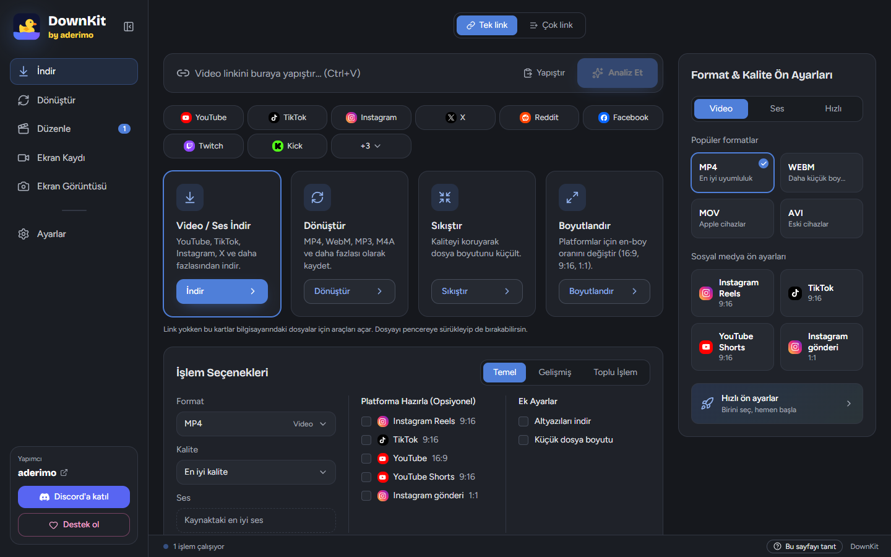
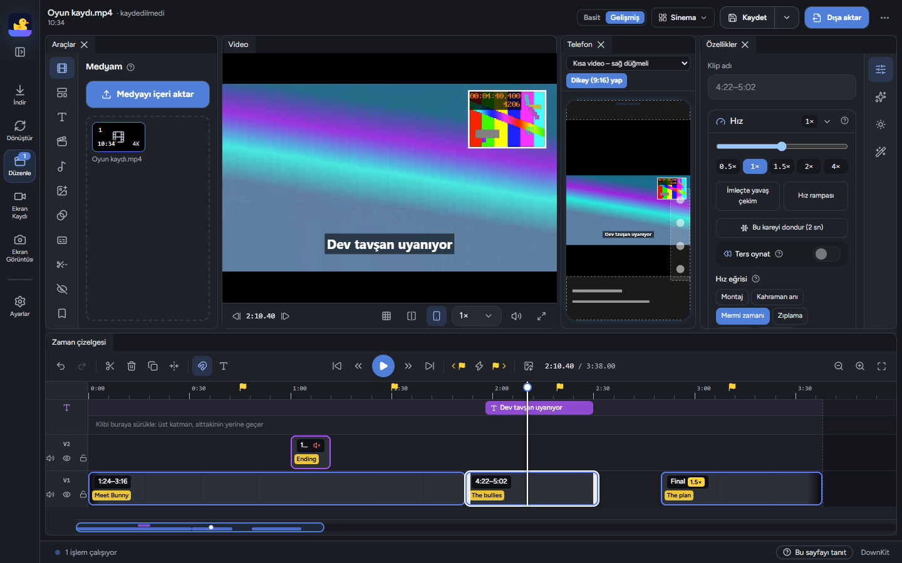
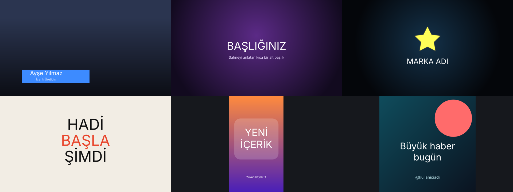
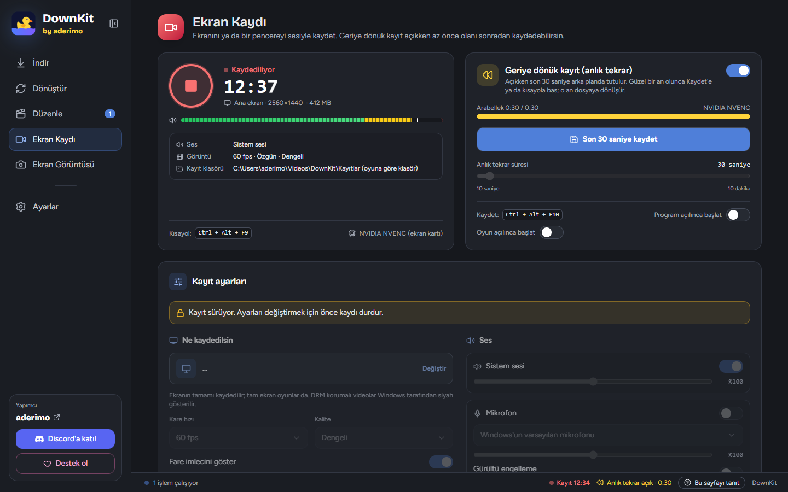
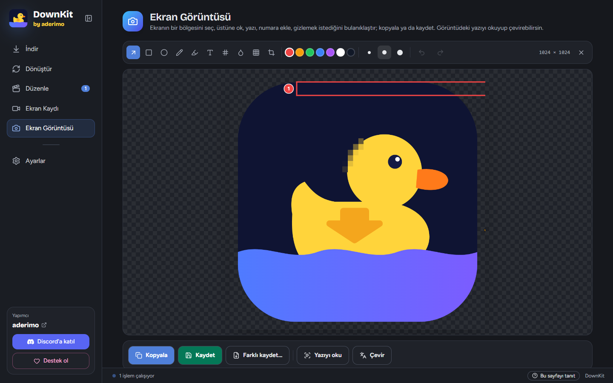

<div align="center">


# DownKit

**İndir. Dönüştür. Düzenle. Kaydet. Yakala.**

Windows için ücretsiz ve açık kaynak medya programı. "Linki yapıştır"dan "hazır klibi paylaş"a
kadar her şey tek pencerede. Hesap yok, reklam yok, ödeme duvarı yok.

[](https://github.com/Aderimo/downkit/releases/latest)
[](https://github.com/Aderimo/downkit/releases)
[](LICENSE)
[](#kurulum)
[](https://discord.gg/z72EaBazJG)

### [⬇ DownKit.exe'yi indir](https://github.com/Aderimo/downkit/releases/latest)

[English](README.md) · **Türkçe**

</div>



---

## Neden DownKit?

Çoğu araç tek bir iş yapar: indirici sana "bir video dosyası" verir; sonra biçimini
değiştirmek için bir dönüştürücü, Discord'a sığdırmak için başka bir araç, kesip başlık
eklemek için bir düzenleyici, ekranını kaydetmek için de bir kayıt programı gerekir. DownKit
hepsini tek, sade bir programda toplar; kodek, bit hızı ya da komut satırı öğrenmen gerekmez.

**Açık kaynaktır** (MIT): herkes kodu okuyabilir, arka planda bir şey yapmadığını görebilir,
iyileştirme önerebilir ya da üzerine bir şey inşa edebilir. Ücretsiz kalacak.

## Neler yapar

### ⬇ Linkten indir

**YouTube, TikTok, Instagram, X, Reddit, Facebook, Twitch, Kick** ve yüzlerce sitenin linkini
yapıştır. MP4, MP3, WebM… ve kaliteyi seç; DownKit önce başlığı, süreyi ve tahmini boyutu
gösterir.

- Uzun bir videonun **yalnızca bir bölümünü** indir — gerisi hiç inmez.
- Oynatma listeleri, altyazı, SponsorBlock, hız sınırı, indirme geçmişi.
- İndirme bitince tek tıkla **düzenleyicide aç**.

### 🔄 Dönüştür, sıkıştır, boyutlandır

Video, ses ya da resmin biçimini değiştir; **hedef boyuta** sıkıştır (ör. Discord için 10 MB
altı); TikTok, Reels ya da Shorts için boyutlandır (9:16, 1:1, 4:5…). Birçok dosyayı bırak,
aynı işi hepsine birden uygula.

### 🎬 Klip düzenleyici



Çok izli zaman çizelgesi, **S** ile böl, boşluğu kapatarak sil, J/L kesme, yumuşatmalı anahtar
kareler, zamanlı yakınlaştırma, 47 geçiş, görünüm efektleri, renk düzeltme, yazı, logo ve
çıkartma, geri al / yinele.

- **Dikey video**: kamera + oyun düzenleri, yüz takibiyle kırpma, güvenli alanlı canlı telefon
  önizlemesi, tek projeden 9:16 / 1:1 / 4:5 / 16:9.
- **Altyazı**: cihazda otomatik altyazı, stil galerisi, konuşulan kelime vurgusu, transkript
  düzenleyici, SRT / VTT.
- **Ses**: gürültü / rüzgâr / yankı onarımı, bas-orta-tiz eşitleyici, sıkıştırıcı, sınırlayıcı,
  sosyal medya ses seviyesi, ritme göre kesme, seslendirme.

### ✨ Hareketli başlıklar



Animasyonlu alt bant, başlık kartı, logo açılışı, ritimli yazı ve sosyal medya şablonları —
metnini yaz, rengini seç, videonun üstüne yerleştir. Açık kaynak
[EffectCraft](https://github.com/storytold/effectcraft) motoruyla çizilir. Lottie (`.json`)
animasyonları da eklenir.

### 🔴 Ekran kaydı ve geriye dönük kayıt



Bir ekranı, bir pencereyi ya da birden çok monitörü masaüstü sesi ve ayrı mikrofon iziyle kaydet.
Geriye dönük kayıt son saniyeleri bellekte tutar; güzel bir an yaşandıktan sonra kısayola bas.

### 📸 Ekran görüntüsü



Dondurulmuş ekranda bir alan seç (**Alt+Shift+S**), ok, yazı ve numaralı adım ekle, gizli
kalması gerekeni bulanıklaştır, sonra kopyala ya da kaydet. Resimdeki yazıyı okuyup (OCR)
çevirebilir.

## Kurulum

[Son sürümden](https://github.com/Aderimo/downkit/releases/latest) indir:

| Dosya                           | Nedir                                       |
| ------------------------------- | ------------------------------------------- |
| **`DownKit-X.Y.Z.exe`**         | Çift tıkla, çalışsın — kurulum yok          |
| `DownKit-X.Y.Z-kurulum.exe`     | Kurulum (Başlat menüsü kısayolu, kaldırıcı) |
| `DownKit-X.Y.Z-tasinabilir.zip` | Aynı `DownKit.exe` zip içinde, en üstte     |
| `SHA256SUMS.txt`                | İndirmeyi doğrulamak için özetler           |

Gereksinimler: Windows 10 / 11 (64 bit) ve Microsoft Edge WebView2 (Windows 11'de hazır gelir).
Windows "bilinmeyen yayımcı" derse: **Ek bilgi → Yine de çalıştır**.

İlk açılışta DownKit FFmpeg, yt-dlp ve Deno'yu bir kez indirir. Ayarlar
`%APPDATA%\com.aderimo.downkit` klasöründedir; DownKit 0.3 ve ClipKit ayarları kendiliğinden
taşınır.

## Gizlilik

Telemetri ve hesap yok. Düzenleme, kayıt ve altyazı bilgisayarında çalışır; dosyaların hiçbir
yere yüklenmez. DownKit internete yalnızca yapıştırdığın linkleri indirmek, araçlarını resmi
sayfalarından almak ve GitHub'da yeni sürüm olup olmadığına bakmak için bağlanır.

Lütfen yalnızca indirme hakkın olan içerikleri indir. DownKit DRM'yi ya da erişim
kısıtlamalarını aşmaz.

## Yapımcı

DownKit'i **aderimo** yaptı.

- 🌐 Tüm bağlantılarım ve sosyal medya hesaplarım: **[gitgit.me/aderimo](https://gitgit.me/aderimo)**
- 💬 Topluluk ve yardım: [Discord](https://discord.gg/z72EaBazJG)
- 🐞 Hata ve öneriler: [GitHub Issues](https://github.com/Aderimo/downkit/issues) — programdaki
  her hatanın yanında bildirimi senin için dolduran bir **Bildir** düğmesi var
- ☕ Projeye destek (isteğe bağlı): [donate.bynogame.com/aderimo](https://donate.bynogame.com/aderimo)

## Geliştirme

Gerekenler: Node.js 22, pnpm, Rust (stable) ve Windows için
[Tauri ön koşulları](https://tauri.app/start/prerequisites/).

```bash
pnpm install
pnpm tauri dev
```

Denetimler: `pnpm typecheck`, `pnpm lint`, `pnpm test`, `pnpm format:check`, `pnpm test:e2e`;
`src-tauri` içinde `cargo fmt --check`, `cargo clippy`, `cargo test --lib`. Paketleme:
`paketle.bat` ([docs/RELEASING.md](docs/RELEASING.md)). Katkı:
[CONTRIBUTING.md](CONTRIBUTING.md).

## Lisans

[MIT](LICENSE) © 2026 aderimo. Ad ve ördek logosu: [TRADEMARKS.md](TRADEMARKS.md). Açık kaynak
bileşenler: [THIRD_PARTY_NOTICES.md](THIRD_PARTY_NOTICES.md).
